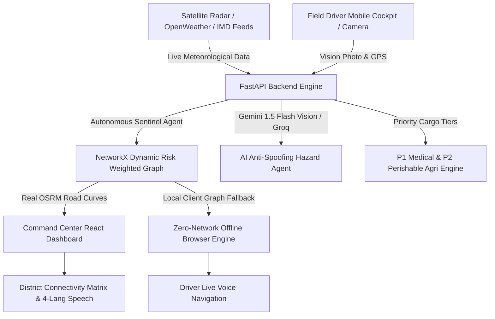

# 🏔️ Route राही (Route Rahi) — AI-Powered Smart & Resilient Logistics Accessibility Intelligence Platform (NER)

> **Smart India Hackathon (SIH 2026) — Complete Production-Ready MVP Solution**  
> *Ministry / Domain: Ministry of Development of North Eastern Region (MDoNER) & Disaster Logistics*  
> *AI-Driven Logistics Accessibility, Multi-Modal Interception, Perishable Supply Chain & Zero-Network Fleet Intelligence.*

---

## 🌟 Project Overview (Project Kya Hai?)

**Route राही (Route Rahi)** ek cutting-edge, AI & Multi-Agent powered **Disaster Logistics & Accessibility Intelligence Platform** hai, jo North Eastern Region (NER) ke mushkil pahaadi raaston, landslides, flash floods, aur cloudbursts ke dauran **Life-Saving Medicines, Perishable Agricultural Produce (Tea, Ginger, Pineapple), Emergency Fuel, aur Relief Rations** ki uninterrupted delivery ensure karta hai.

Yeh platform **Central State Disaster Authorities (HQ Command Center)** ko centralized visibility deta hai aur sath hi **Remote Truck Drivers & Field Officials** ko zero-network hill areas me real-time voice guidance aur incident reporting provide karta hai.

---

## 🎯 SIH Problem Statement Parameters vs Route राही Implementation

| SIH Parameter | Problem Requirement | Route राही Implementation |
|---|---|---|
| **(a) Real-Time Monitoring** | Road, bridge, and transport accessibility across districts | 🛰️ **Interactive GIS Map & District Matrix** covering 8 NER states, 29 strategic hubs, 49 corridors, and multi-modal transit (**NW-2 Brahmaputra Riverways, NFR Rail, Air/Drone Corridors**). |
| **(b) Predictive Disruptions** | Landslides, floods, heavy rainfall, road damage prediction | ⛈️ **OpenWeatherMap 5-Day Forecast + Autonomous Sentinel Agent** jo Doppler radar aur rainfall accumulation se slope failure aur flash flood risk score calculate karta hai. |
| **(c) AI Alternate Rerouting** | AI-based bypass suggestions & estimated travel delay | ⚡ **NetworkX Risk-Weighted Dijkstra Graph Engine** jo road block hote hi instantly lowest-risk mountain pass bypass calculate karke exact delay (mins) & ETA batata hai. |
| **(d) Essential Tracking** | GPS tracking of medicines, agri-produce, fuel, rations | 🚛 **Live Fleet Telemetry HUD** with **3 Priority Tiers**: **P1** (Medicines & Oxygen Green Corridor), **P2** (Perishable Agri-Produce with 24-48h spoilage window), **P3** (Rations & Fuel). |
| **(e) Automated Alerts** | Audio sirens, instant SMS alerts, dynamic rerouting | 🚨 **Web Audio Native Sirens + Twilio SMS Gateway** jo high-risk roadblock ya driver SOS hote hi instant siren alarm aur dynamic SMS notification trigger karta hai. |
| **(f) Field Reporting** | Geo-tagged photo reporting + incident uploads | 📸 **Mobile Driver Cockpit (`/driver`)** with **Google Gemini 1.5 Flash Vision AI** — photo snap karte hi hazard type, severity (0-10), aur geo-tag (`lat, lon`) auto-fill ho jata hai. |
| **(g) Centralized Dashboard** | District connectivity & logistics bottleneck matrix | 📊 **Centralized Command Center** — 8 NER states ka live accessibility score (%), hospital medicine/fuel buffer days, aur seasonal demand forecast analytics. |
| **(h) Multilingual & Offline** | Regional languages & zero-network resilience | 🌐 **4 Languages (English, हिंदी, অসমীয়া, বাংলা)** + **Web Speech Voice Guidance** + **Client-Side Offline Dijkstra Engine** + **LocalStorage Auto-Sync Queue** for zero-network mountain valleys. |

---

## 🚀 Key USPs & Technical Innovations

### 1. 👁️ Gemini 1.5 Flash Vision AI with Anti-Spoofing Validation
- **Road Hazard Inspection**: Field drivers aur patrol officers toote bridge ya landslide ki photo upload karte hain; Vision AI seconds me physical hazard classify karta hai.
- **False Report & Safe Road Detection**: Agar koi fake photo (selfie, indoor, animal) ya normal clear road upload kare, toh system **`severity: 0`** mark karke false alarm ko reject kar deta hai aur route divert nahi karta.

### 2. 🤖 Autonomous Sentinel Multi-Agent System
- **Preemptive Interception**: System pahaadon par haadsa hone ka intezar nahi karta — satellite radar aur precipitation sensors se risk calculate karke **gaadiyon ke enter hone se pehle hi green corridor bypass activate kar deta hai**.

### 3. 🚢 Multi-Modal Redundancy (NW-2 Waterways, Rail & Air)
- Jab pahaadi highways (NH-37, NH-6, NH-44) heavy monsoon me toot jaate hain, toh platform automatically bulk freight ko **NW-2 Brahmaputra River Barges (Pandu Port, Silghat, Neamatighat)** aur **NFR Railway** par divert kar deta hai.

### 4. 🌾 Perishable Agricultural Produce Priority (Farmer First)
- North East ke tea gardens aur organic ginger/pineapple farmers ke nuksan ko rokne ke liye perishable consignments ko **time-critical 24–48 hour spoilage window** ke sath priority di jati hai.

### 5. ⛰️ Mountain Terrain Elevation & Diesel Cost Engine
- Real-world ghat elevation gain (+1240m altitude climb), steep hairpin curves, aur 10-ton freight truck ke liye diesel fuel consumption (Liters + INR ₹) aur carbon emissions ($CO_2$ kg) calculate karta hai.

### 6. 📶 Zero-Network Local-First Offline Resilience
- **Offline Routing**: Jab truck internet-less mountain gorge me enter karta hai, tab browser memory me stored **Pure JavaScript Dijkstra Engine** turn-by-turn guidance continue rakhta hai.
- **Offline Incident Queue**: Offline dauran liye gaye hazard reports browser `localStorage` me save hote hain aur network aate hi automatically server par flush ho jaate hain.

### 7. 📱 1-Tap Driver Mobile Cockpit (`/driver`) & SOS Diversion
- Driver phone ke liye dedicated thumb-friendly HUD jisme live compass gyroscope beam cone, real phone GPS tracker, night HUD mode, aur emergency 1-Tap SOS Diversion button shamil hai.

---

## 🛠️ Architecture & Tech Stack



- **Frontend**: React 18, Leaflet GIS, Web Audio API (Sirens), Web Speech Synthesis API (Voice Nav), Tailwind CSS tokens, Lucide Icons.
- **Backend**: Python 3.12, FastAPI (Async REST APIs), NetworkX Graph Algorithms, Uvicorn ASGI, Pydantic.
- **AI & Computer Vision**: Google Gemini 1.5 Flash Vision, Groq LLaVA Vision (Llama 3.2 Vision), Groq LLM Co-Pilot.
- **Geospatial & Spatial**: OpenStreetMap (OSM) Carto Tiles, MapTiler Streets/Dark, OSRM Road Geometries, Haversine Spherical Distance.

---

## ⚡ Quick Start Guide (Kaise Run Karein?)

### Method 1: Double Click (Super Easy)
Root folder me maujood **`RUN_APP.bat`** file par double-click karein. Backend aur Frontend dono automatically start ho jayenge.

### Method 2: Manual Terminal Commands
```bash
# 1. Start FastAPI Backend (Port 8000)
cd backend
.\venv\Scripts\python.exe -m uvicorn main:app --reload --host 0.0.0.0 --port 8000

# 2. Start Frontend Vite App (Port 5173 / 5174)
cd frontend
npm run dev
```

### 🌐 Access URLs:
- 🖥️ **HQ Command Center**: `http://localhost:5173`
- 📱 **Driver Mobile Cockpit**: `http://localhost:5173/driver`
- ⚡ **Interactive API Docs (Swagger)**: `http://localhost:8000/docs`

---

## 📱 Mobile Phone Live GPS Testing (QR Code Sync)
1. Laptop aur mobile phone ko **same Wi-Fi ya laptop mobile hotspot** se connect karein.
2. Dashboard header me **"📱 Connect Mobile"** par click karein.
3. Apne mobile phone se screen par dikh raha **QR Code scan karein** — aapka mobile live field GPS unit ban jayega!

---

## 👥 Team & Hackathon Metadata
- **Event**: Smart India Hackathon (SIH 2026)
- **Domain**: Disaster Management, Logistics & Transportation, AI & GIS Intelligence
- **Status**: Production-Ready MVP (100% Parameter Compliant)
